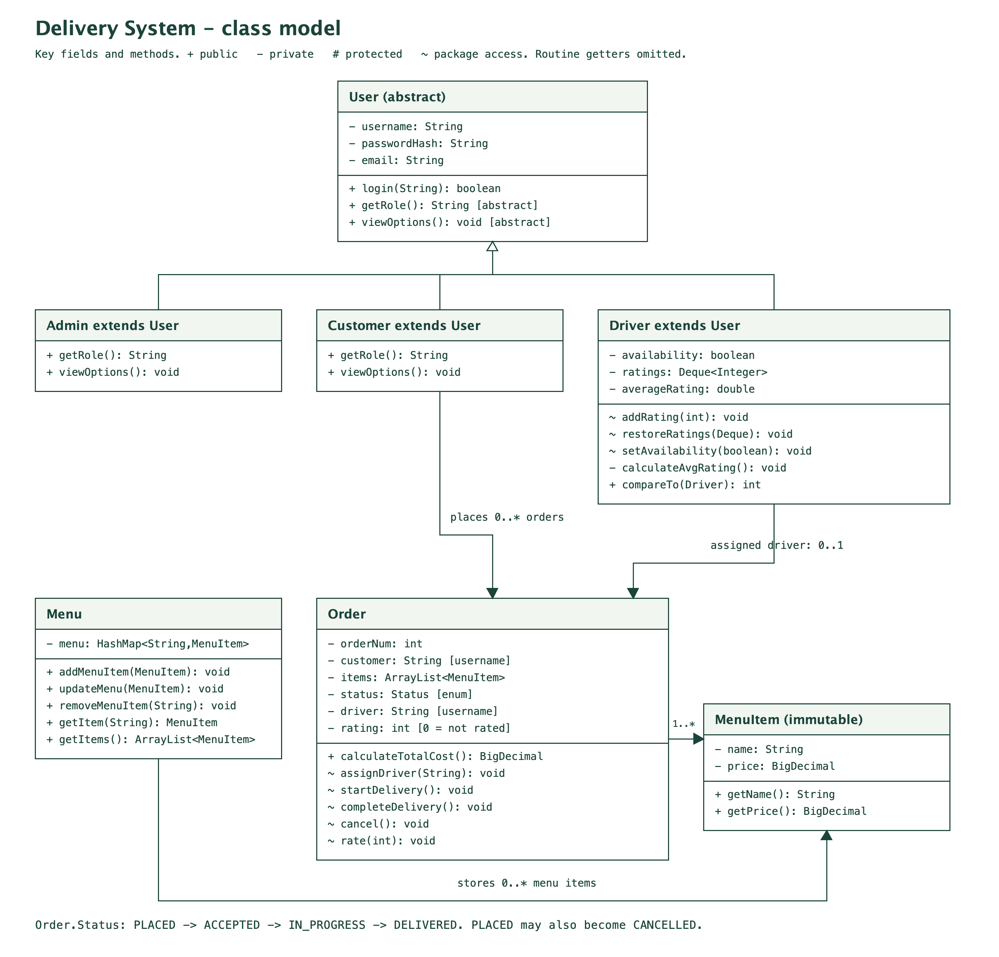

# CS233 Delivery System

This is our food delivery project for CS 233. Customers order food, drivers
deliver it, and admins handle the menu. We're using Java for the whole thing,
including the desktop UI. There's a terminal version too.

[Our project outline](https://docs.google.com/document/d/1l-lTCzXPiRaTFfb3K3Sh9lbH9hS9wgrCx4MCd-MhfPU/edit?usp=sharing)

## Running it

You need a JDK installed, not just the Java runtime. The source targets Java 17
or newer; the current local tests run on Java 21.

On Windows, open the project folder in PowerShell and run:

```powershell
.\run.bat
```

On a Mac or Linux:

```sh
./run.sh
```

That compiles the code and opens the desktop app. Add `--cli` if you want the
terminal version instead. The scripts work even if the folder path has spaces.

## Accounts to try

The first run creates these demo accounts:

| Role | Username | Password |
| --- | --- | --- |
| Admin | admin | admin123 |
| Customer | customer | customer123 |
| Driver | driver1 | driver123 |
| Driver | driver2 | driver123 |

Customers can also make their own account. Admins can add accounts for any role.
Everyone can change their email and password from their profile.

## The three dashboards

- Customers can browse food, put together an order, check its status, and rate
  the driver after delivery. An order can be cancelled while it's waiting.
- Drivers see their assigned orders and mark them in progress or delivered.
  They can also see their recent ratings and average.
- Admins can add, remove, and update menu items, view all orders, and add users.

Each dashboard has an Activity page. It shows the requests going into our Java
code and the files being read or saved. The entries come from actual operations
and stay in `activity.txt` between runs. Customers and drivers see their own
activity; admins see everyone's. Passwords and password hashes aren't logged.
The page shows the latest 200 matching entries, with the full history kept in
the file. This version runs locally, so there aren't any network requests.

## How orders work

Waiting orders use a queue, so the oldest order gets accepted first. Available
drivers use a priority queue, with the highest-rated driver first. If two drivers
have the same average, their usernames break the tie. New drivers start at zero
until they get a rating.

A driver handles one order at a time. Finishing a delivery puts them back in the
pool, and the next waiting order gets assigned automatically. We only keep their
last ten ratings. When an eleventh rating comes in, the oldest one gets dropped.

Orders keep their checkout prices, so changing the menu doesn't change an old
order's total. Prices use `BigDecimal` to keep cents exact.

## Saved files

Running from the project folder creates a `data` folder with `Menu.txt`,
`customers.txt`, `drivers.txt`, `admins.txt`, `orders.txt`, and `activity.txt`.
The root `Menu.txt` is the starting menu; after the first run, menu changes go
in `data/Menu.txt`. User files store salted password hashes.

New orders and status changes get appended to `orders.txt`. On startup, the app
reads that log to restore orders, ratings, waiting orders, and busy drivers.
Broken or missing data gets reported instead of replaced with fresh demo data.
Only one copy of the app can use a data folder at a time.

For a separate set of demo data, run `./run.sh --data-dir "some folder"` on a Mac,
or `.\run.bat --data-dir "some folder"` on Windows.

## Building and testing

Run `./test.sh` on a Mac or `.\test.bat` on Windows. These tests use temporary
files and cover ordering, driver assignment, ratings, permissions, logging,
and restarting the app.

Add `--desktop` to run the button-handler checks and generate screen previews
without opening a window: `./test.sh --desktop` or `.\test.bat --desktop`.
Generated test previews go in `build/previews`, so running the tests doesn't
change the images saved in the repo.
The local results are 89 backend checks, 10 terminal/JAR checks, and 27 desktop checks.

`./build.sh` or `.\build.bat` creates `build/app/CS233DeliverySystem.jar` and
copies the starting menu beside it. Keep those two files together. You can run
the JAR with `java -jar CS233DeliverySystem.jar`. When launched outside the project
folder, it saves data in `.cs233-delivery` under your user folder.

The same source and Windows launcher are included. The current local checks are
on macOS; the Windows desktop still needs a run on a Windows machine.

## Class diagram



- [Current class model](docs/current-class-model.png) / [editable](docs/current-class-model.excalidraw)
- [App structure](docs/current-app-structure.png) / [editable](docs/current-app-structure.excalidraw)
- [Design notes and OOP explanations](docs/design.md)
- [Design PDF](output/pdf/CS233_Nobody_Loves_Java.pdf)
- [Demo walkthrough](docs/demo.md)

The original design is kept here too:

- [PNG](docs/class-diagram.png)
- [Editable drawing](docs/class-diagram.excalidraw)
- [Original drawing](Drawing%202026-10-21%2010.26.37.excalidraw.md)

## Screen previews

These are the actual Swing panels rendered with temporary demo data.

- [Login](docs/screenshots/login.png)
- [Customer](docs/screenshots/customer.png)
- [Driver](docs/screenshots/driver.png)
- [Admin](docs/screenshots/admin.png)
- [Activity log](docs/screenshots/admin-activity.png)

## Windows check

The Windows launchers and desktop tests are ready. An Actions workflow for
Windows, macOS, and Linux is prepared locally in `.github/workflows/java.yml`.
GitHub's current connection permissions block uploading workflow files, so
the Windows runtime check is still pending. The local Mac checks pass.
The same [prepared workflow](docs/java-checks.yml) is included as an inactive
template. Someone with workflow access can copy it to `.github/workflows/java.yml`
to turn on those checks.

## Due dates

- November 16, 2026: show the core classes, login, file I/O, and placing an order.
- November 30, 2026: submit the code and demonstrate the complete system.
