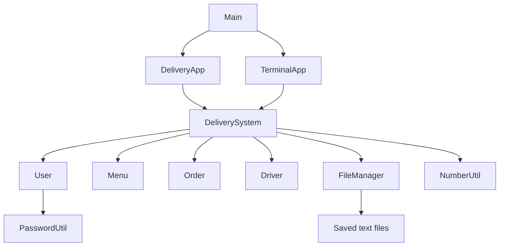

# Function guide

This explains the methods in our Java source, including the private helpers.
The short comments above the methods are there to help while reading code;
this guide gives the longer explanation of what happens and why.

## Start with the flow

`Main.main()` loads the saved system and picks an interface. `DeliveryApp`
handles buttons and screens. `TerminalApp` handles typed menu choices. Both
call `DeliverySystem`, which checks permissions and applies the delivery rules.
`FileManager` reads and saves the text files. The interface does not get to skip
the backend rules just because a button is enabled.

For example, clicking **Place order** builds a list of food names and calls
`DeliverySystem.placeOrder()`. That method checks the customer, looks up the
current menu items, appends a placed order, and adds it to the FIFO queue.
`giveOrderToDriver()` takes the oldest waiting order and the highest-rated
available driver, saves the accepted order, and marks that driver busy.

Some methods return copies. This matters because the UI should not be able to
clear the real ratings, change the waiting queue, or rewrite an old order's
checkout prices just by changing a returned object.

## The numeric types

Prices, totals, individual ratings, and rating averages are `float`. Write a
Java literal as `4.5f` when a method needs a float; `4.5` by itself is a double.
Java collections hold objects, so `Deque<Float>` uses the wrapper `Float`.
Order numbers, quantities, and list positions stay `int` because they count
whole things.

A float is a binary approximation. For example, adding `0.1f` and `0.2f` can
leave a small extra fraction. The cart and checkout add rounded float cents through the same helper, then
convert back to dollars and format money to two decimal places. This produces the intended display for normal demo amounts;
it does not give floats exact decimal arithmetic or unlimited precision for
large amounts. Non-finite values such as NaN and infinity are rejected.

## Main

| Method | What it does | Why we use it |
| --- | --- | --- |
| `main(String[] args)` | Reads `--cli`, `--data-dir`, and `--help`; finds the starting menu; opens the shared system; starts the chosen interface. | Gives the app one entry point. The CLI uses try-with-resources so its data lock closes on exit; Swing starts on its event thread. |

Java also supplies an implicit `Main()` constructor because none is declared.
We do not call it; the entry point is static. The implicit `Menu()` constructor
is used when creating a menu and runs the field initializer for its empty hash map.

## NumberUtil

| Method | What it does | Why we use it |
| --- | --- | --- |
| `NumberUtil()` | Private constructor; callers cannot create this helper as an object. | Its methods only operate on supplied numbers, so an instance would hold no useful state. |
| `parsePrice(String text)` | Trims text, parses a float, and passes it to `requirePrice()`. Invalid numeric text gets a price-specific message. | Both interfaces and the menu reader interpret prices the same way. |
| `requirePrice(float price)` | Rejects negative or non-finite prices and values that change when rounded to cents. Returns an accepted price. | A constructor or backend call must follow the price rules even when no text field was used. |
| `roundMoney(float amount)` | Formats to cents and parses that result back to a float. | Keeps computed checkout totals as floats while removing ordinary small fractional-cent calculation residue. |
| `totalCost(List<MenuItem> items)` | Rounds each unit price to float cents, adds the cents, and converts the result back to float dollars. | The cart and saved order use one calculation. It avoids ordinary cumulative dollar-addition errors such as 100 items at $99.99 becoming $9999.01. Float precision is still limited for very large amounts. |
| `formatMoney(float amount)` | Rejects invalid amounts and returns a string with exactly two decimal places using `Locale.ROOT`. | Screens and saved prices use a consistent decimal point and do not show `$3.1` or a long float tail. |
| `parseRating(String text)` | Parses decimal text such as `4.5`, then checks the range. | The CLI and saved rating lists can accept decimals and old integer-looking text such as `5`. |
| `requireRating(float rating)` | Requires a finite value from 1 through 5. | The order, driver, and input parsing share the same rule; a comparison alone would fail to reject NaN. |

## User

`User` is abstract. An account is created as an `Admin`, `Customer`, or `Driver`.
Those subclasses share the account information and password-checking code.

| Method | What it does | Why we use it |
| --- | --- | --- |
| `User(username, passwordHash, email)` | Normalizes the username, checks the saved password hash, and validates the email. | Every role starts with a valid common account record. The constructor takes a hash, not a plaintext password. |
| `login(String password)` | Asks `PasswordUtil.matches()` whether the supplied password matches this account. | Password comparison stays behind the account API; callers do not need to inspect its hash. |
| `getUsername()` | Returns the account's fixed username. | Orders and file records use this value as their account identifier. |
| `getEmail()` | Returns the current email. | Profile screens can display it without exposing the field directly. |
| `getPasswordHash()` | Returns the hash with package access. | Persistence needs to save it, but it is not part of the public dashboard API. |
| `setPasswordHash(String passwordHash)` | Replaces the stored hash. | This is a package helper; the current profile-change flow instead constructs and saves a replacement user object. It is not a dashboard action. |
| `setEmail(String email)` | Checks a basic email pattern and rejects saved-field separators or whitespace. | Keeps malformed profile text out of the account files. This is a basic format check, not proof that an address exists. |
| `normalizeUsername(String username)` | Checks length/characters, trims, and lowercases using a fixed locale. | `CUSTOMER` and `customer` resolve to the same account and cannot become duplicate usernames. |
| `getRole()` | Abstract method implemented by each role. | The shared `User` type can report which dashboard and user file apply to its actual subclass. |
| `viewOptions()` | Abstract method implemented by each role. | The CLI calls one method through a `User` variable and receives different menus through polymorphism. |

## Admin and Customer

| Class and method | What it does | Why we use it |
| --- | --- | --- |
| `Admin(username, hash, email)` | Calls the shared user constructor. | Reuses account validation while creating an admin object. |
| `Admin.getRole()` | Returns `Admin`. | Selects the admin dashboard, role checks, and admin persistence file. |
| `Admin.viewOptions()` | Prints menu management, all orders, account creation, drivers, profile, activity, and logout choices. | Keeps the admin CLI menu with its role. The backend still checks permission for each action. |
| `Customer(username, hash, email)` | Calls the shared user constructor. | Reuses validation while creating a customer object. |
| `Customer.getRole()` | Returns `Customer`. | Selects customer actions and the customer persistence file. |
| `Customer.viewOptions()` | Prints ordering, history, rating, cancellation, profile, activity, and logout choices. | Customers see choices relevant to their own orders. |

## Driver

The deque stores ratings oldest first. The priority queue uses `compareTo()`
to put the highest average first. A driver with no ratings starts at zero.

| Method | What it does | Why we use it |
| --- | --- | --- |
| `Driver(username, hash, email)` | Initializes the account with an empty rating list and available state. | New drivers can enter the pool without special rating records. |
| `getRole()` | Returns `Driver`. | Chooses the driver interface and file. |
| `viewOptions()` | Prints delivery, rating-history, profile, activity, and logout options. | Keeps driver CLI choices distinct from customer ordering actions. |
| `getAvailability()` | Returns whether the driver can take an order. | Assignment and the admin driver list need the same state. |
| `setAvailability(boolean)` | Changes that state. | The backend marks a driver busy after assignment and free after completion or cancellation. |
| `getAverageRating()` | Returns the stored float average. | Driver priority and the rating screen can read the result without recalculating it separately. |
| `getRatings()` | Returns a new deque containing the ratings. | A caller cannot remove a real rating by changing the returned list. |
| `addRating(float)` | Validates a rating, drops the oldest at the ten-rating limit, adds the newest, and recalculates. | Encapsulates the deque rule. The normal backend rating flow uses a proposed snapshot instead so the order event can be saved before changing the driver. |
| `restoreRatings(Deque<Float>)` | Validates the size and every value, replaces the list, and recalculates. | Startup and successfully saved rating events can rebuild the same driver state. |
| `calculateAvgRating()` | Sums at most ten float ratings and divides by their count; returns zero through the stored field for an empty list. | Keeps the average consistent with exactly the retained ratings. |
| `compareTo(Driver other)` | Uses `Float.compare(other.averageRating, averageRating)`, then username for ties. | Java's priority queue returns its smallest comparison value. Reversing the rating comparison makes the highest average come out first; usernames make ties predictable. |

## MenuItem and Menu

`MenuItem` is immutable. Replacing a menu price creates a new item, so old
orders can keep their original item objects and checkout prices.

| Class and method | What it does | Why we use it |
| --- | --- | --- |
| `MenuItem(name, float price)` | Validates the name and price, then stores both final fields. | Stops bad prices and text that could break the saved record format. |
| `MenuItem.getName()` | Returns the display name. | The menu, cart, and history can identify food without changing it. |
| `MenuItem.getPrice()` | Returns the float unit price. | Totals use the value that belongs to that item snapshot. |
| `Menu.addMenuItem(MenuItem)` | Adds an item under its lowercase name and rejects duplicates. | A hash map gives direct lookup and prevents differently capitalized duplicate foods. |
| `Menu.updateMenu(MenuItem)` | Requires an existing item and replaces its current menu entry. | An update cannot accidentally become an add, and existing order snapshots stay intact. |
| `Menu.removeMenuItem(String)` | Checks existence, then removes the normalized key. | Removed food disappears from future ordering, while old orders still retain their items. |
| `Menu.getItem(String)` | Looks up a trimmed, lowercase name or throws a useful error. | Backend ordering can validate each selected food using one consistent lookup. |
| `Menu.getItems()` | Returns a separate, alphabetically sorted list. | Screen and file ordering are stable even though a hash map itself has no display order. |

## Order

The normal state path is `PLACED → ACCEPTED → IN_PROGRESS → DELIVERED`.
Placed and accepted orders can instead become cancelled. A rating of zero
means not rated; an actual submitted rating must be from 1 to 5.

| Method | What it does | Why we use it |
| --- | --- | --- |
| `Order(number, customer, items)` | Creates a placed order with no assigned driver and no rating. | New orders always start in the same valid state. |
| `Order(number, customer, items, status, driver, float rating)` | Restores or copies an order after checking IDs, item count, rating, and driver/status consistency. | Corrupt file data and invalid copies cannot silently enter the live system. |
| `getOrderId()` | Returns the unique order number. | Buttons, CLI prompts, and log updates refer to a stable identifier. |
| `getCustomer()` | Returns the owning customer's username. | The backend can check ownership without exposing a mutable customer object. |
| `getItems()` | Returns a separate list of immutable menu items. | Screens can inspect checkout contents without changing the real order. |
| `getStatus()` | Returns the current enum state. | Available actions can be based on a fixed set of states instead of arbitrary strings. |
| `getDriver()` | Returns the driver's username, or an empty string if none was assigned. | History and ownership checks can retain the assignment even after cancellation. |
| `getRating()` | Returns the saved float rating, or zero. | The UI knows whether to show a rating or offer the rating action. |
| `calculateTotalCost()` | Passes snapshot unit prices to the shared float-cent total calculation. | Changing today's menu does not change what an earlier customer ordered at checkout. |
| `copy()` | Constructs a separate order with the same values. | The system can validate and save a proposed change before replacing its in-memory order. |
| `assignDriver(String)` | Requires placed status, stores a normalized driver, and changes to accepted. | An already assigned or completed order cannot be assigned a second time. |
| `startDelivery()` | Requires accepted status and changes to in progress. | A driver cannot start a waiting, cancelled, or completed order. |
| `completeDelivery()` | Requires in-progress status and changes to delivered. | Completion cannot skip the delivery-start step. |
| `canCancel()` | Returns true for placed or accepted status. | The UI and model use the same cancellation eligibility rule. |
| `cancel()` | Checks eligibility and changes to cancelled without erasing the assigned driver. | Customers can cancel before delivery starts while preserving useful history. Driver availability is handled by the backend. |
| `rate(float)` | Requires delivered status, rejects a second rating, and validates the new value. | Only completed deliveries receive one valid customer rating. |
| `requireStatus(Status)` | Throws when the current state differs from the required state. | State transitions share a clear guard and error message. |

## DeliverySystem

This class owns the live user lookup, all orders, the waiting-order queue, and
the ready-driver priority queue. Most UI/CLI actions should reach this class.

| Method | What it does | Why we use it |
| --- | --- | --- |
| `DeliverySystem(directory, startingMenu)` | Opens persistence, loads users/menu/orders, reconstructs waiting and busy states, builds the driver pool, and tries waiting assignments. | A restart should recover the same delivery state rather than starting a new demo. It also closes the lock if startup fails. |
| `createUser(role, username, hash, email)` | Constructs the correct role subclass. | File loading and account creation use one role-to-class mapping. |
| `login(username, password)` | Requires no current session, checks the normalized account and password, sets the current user/log actor, and records login. | Credentials and the saved role decide which dashboard opens. |
| `logout()` | Records logout and clears the current user and activity actor. | Later actions cannot continue under the previous account. |
| `getCurrentUser()` | Returns the current session's user. | The two interfaces can choose the correct role menu. |
| `register(role, username, password, email)` | Allows public customer sign-up or admin-created accounts, checks uniqueness, hashes the password, saves a proposed user list, then adds the user. New drivers enter assignment. | Permission and persistence rules are enforced even outside the GUI. |
| `changeInfo(email, newPassword)` | Builds a replacement user, preserves driver state, saves it, and updates the session and driver pool. | A failed save should not leave an unsaved profile change installed in memory. |
| `getMenuItems()` | Requires login and returns sorted menu items. | Both interfaces read one current menu. |
| `addMenuItem(name, float price)` | Requires admin, changes a copy, logs the request, saves, and installs the new menu. | Menu editing follows permissions and does not change the live menu before saving succeeds. |
| `updateMenu(name, float price)` | Performs the same saved-copy flow for an existing price. | Old checkout snapshots remain separate from new menu prices. |
| `removeMenuItem(name)` | Performs the saved-copy flow for a removal. | Removed items stop appearing in future orders without erasing history. |
| `copyMenu()` | Builds another menu from the current immutable items. | Admin operations can be prepared and saved without immediately mutating the active menu. |
| `placeOrder(foodNames)` | Requires a customer, validates 1–100 items and the next number, builds snapshots, saves a placed event, queues it, and tries assignment. Returns a copy. | FIFO acceptance, saved transaction history, and totals are handled together. |
| `giveOrderToDriver()` | While both pools have entries, assigns the oldest waiting order to the best available driver, appends accepted state, removes both heads, and saves busy status. | The queue preserves received order; the heap selects driver priority efficiently. |
| `getMyOrders()` | Returns order copies belonging to the current customer or assigned driver. | Customers and drivers cannot read unrelated orders through the dashboard API. |
| `getAllOrders()` | Requires admin and returns copies of all orders. | The all-orders dashboard is an explicit admin capability. |
| `getDrivers()` | Requires admin and returns sorted driver copies with their availability and ratings. | Admin display cannot accidentally modify the actual assignment pool. |
| `cancelOrder(int id)` | Checks customer ownership, saves cancelled state, removes a waiting queue entry, and frees/reuses any assigned driver. | Cancellation must update persistence, queue membership, and availability together. |
| `startDelivery(int id)` | Requires the assigned driver, changes a copy to in progress, appends it, and installs it. | One driver cannot start another driver's delivery. |
| `completeDelivery(int id)` | Saves delivered state, returns the driver to the heap, saves driver status, and assigns the next waiting order. | Completing one order makes delivery capacity available again. |
| `rateDriver(int id, float rating)` | Checks customer ownership and delivery state, builds the latest-ten rating snapshot, appends the rated order, restores driver ratings, and saves the driver. | The order log can recover the new rating even if a later driver-file save is interrupted. Available drivers are removed/reinserted so changed averages do not leave the heap stale. |
| `getActivity()` | Requires login and loads activity allowed for that user. | Customers and drivers receive their own events; admins can inspect all roles. |
| `ownedOrder(id, driver)` | Finds an order and checks either its customer or driver against the session. | Ownership checks are shared by status, cancellation, and rating actions. |
| `requireLogin()` | Rejects an action with no current account. | Backend actions cannot rely only on whether the login screen is visible. |
| `requireRole(Class)` | Checks login and the current user's subclass. | Calling an admin/driver method directly cannot bypass role restrictions. |
| `close()` | Closes the file manager. | Try-with-resources and window shutdown can release the data-folder lock. |

## FileManager

User and menu snapshots replace a file through a temporary file. Order and
activity events append to their logs. These are not one database transaction;
the app reports an I/O failure and closes, and startup replays completed order
appends. It does not silently repair arbitrary malformed records.

| Method | What it does | Why we use it |
| --- | --- | --- |
| `FileManager(directory, startingMenu)` | Creates the directory, opens and acquires a file lock, then checks/initializes files. | Two app processes must not overwrite the same data. Initialization failure releases the lock. |
| `initializeFiles(Path)` | Creates demo files only if none of the six data files exist; reports a partly missing set. | Missing files in existing data should not be replaced with fresh demo accounts. |
| `loadMenu()` | Reads the working menu and logs its load. | Startup uses persisted admin changes after the first run. |
| `readMenu(Path)` | Skips comments, splits at the last comma, removes supported outer quotes, parses float prices, and reports file/line errors. | The starting and saved menu formats share one parser; quoted names beginning with `#` remain real food names. |
| `saveMenu(Menu)` | Writes quoted names and two-decimal prices through `writeFile()`. | Menu names round-trip and saves do not rewrite old orders. |
| `loadUsers()` | Reads all three role files, checks record fields and duplicate usernames, restores driver float ratings, and constructs subclasses. | Roles, credentials, and driver history survive restart in a single account lookup. |
| `saveUsers(users, role)` | Writes one role's account snapshot, including driver availability and ratings. | Updating drivers does not require rewriting customer/admin files. Password hashes are saved instead of plaintext passwords. |
| `loadOrders(users)` | Replays events by order ID, validates users/items/transitions, retains each latest state, and restores driver rating snapshots. | Appended history rebuilds active orders, FIFO order, ratings, and the next order number. |
| `validateTransition(previous, next)` | Checks unchanged customer/items/prices, legal state progression, and unchanged drivers outside the initial assignment. | A modified or broken log cannot silently rewrite an order's identity or skip delivery steps. |
| `appendOrder(order, ratings)` | Appends a full order snapshot, its float rating history, and two-decimal item prices; logs the successful save. | Each change is retained as a transaction event instead of replacing the entire order history. |
| `parseRatings(String)` | Parses comma-separated float ratings in received order and enforces the range and ten-entry limit. | Old integer text and new decimal ratings load through the same parser. |
| `formatRatings(Deque<Float>)` | Joins numeric ratings with commas, oldest first. | Saving retains exactly the order needed to replace the oldest rating later. |
| `userFile(String role)` | Selects the filename for a recognized role. | File naming is kept in one place. |
| `writeFile(name, text)` | Writes a temporary file, moves it over the target atomically when supported, logs success, and removes leftovers. | An incomplete snapshot should not replace the previous complete one while it is still being written. |
| `badRecord(path, line, cause)` | Wraps a parsing failure in an IOException naming the file and line. | Saved-data problems become actionable messages instead of unexplained number-format exceptions. |
| `setActor(User)` | Sets the role and username used for later log events, or system identity without a user. | Requests and file saves are attributed to their session. |
| `log(event, details)` | Removes field-breaking bars/newlines from details and appends UTC time, actor, event, and details. | Activity is based on real operations and stays readable as one event per line. Callers avoid credentials. |
| `loadActivity(User)` | Checks records, filters by user unless admin, and retains the latest 200 matching entries for display. | A screen stays bounded while the file retains the full history. |
| `close()` | Releases the acquired lock and closes its channel. | Another app instance can use that data folder after this instance exits. |

## PasswordUtil and ActivityEntry

| Class and method | What it does | Why we use it |
| --- | --- | --- |
| `PasswordUtil()` | Private constructor for static helpers. | There is no per-object password state to hold. |
| `PasswordUtil.hash(password)` | Checks password length, generates a random salt, derives a hash, and includes the format/iteration count/salt in the saved string. | Different accounts using the same password do not need identical saved hashes. |
| `PasswordUtil.matches(password, savedHash)` | Validates the saved format, derives using its salt, and compares hash bytes with `MessageDigest.isEqual()`. | Login compares derived results instead of storing or recovering plaintext passwords. |
| `PasswordUtil.isValidHash(hash)` | Checks format, configured iteration count, Base64 data, salt size, and hash size. | Broken credential files are rejected while loading rather than failing unpredictably during login. |
| `PasswordUtil.derive(password, salt)` | Uses PBKDF2WithHmacSHA256 with 120,000 iterations and clears the temporary password specification. | Hash creation and password checking use the same derivation parameters. |
| `ActivityEntry(time, role, username, event, details)` | Stores one immutable activity record. | Table rows can read events without changing the log entry. |
| `ActivityEntry.getTime()` | Returns its saved UTC time string. | The activity page can convert it to the local display time. |
| `ActivityEntry.getRole()` | Returns its actor role. | Admins can distinguish system/customer/driver/admin events. |
| `ActivityEntry.getUsername()` | Returns its actor name. | Filtering and display can identify whose request produced the entry. |
| `ActivityEntry.getEvent()` | Returns its event label. | The screen distinguishes requests, reads, saves, logins, and other actions. |
| `ActivityEntry.getDetails()` | Returns its descriptive message. | Users can see what changed without needing raw account-file contents. |

## TerminalApp

The terminal reads complete lines rather than mixing `nextInt()` and
`nextLine()`. Whole-number parsing is only for IDs/menu counts; ratings and
prices go through float parsing.

| Method | What it does | Why we use it |
| --- | --- | --- |
| `TerminalApp(DeliverySystem)` | Stores the shared backend. | CLI and GUI operate under the same rules. |
| `run()` | Loops over login/sign-up or the current role's options, dispatches choices, handles input errors, and exits on 0/end-of-input. | A normal invalid choice should return to the menu instead of ending the program. |
| `adminOption(String)` | Routes menu changes, order viewing, account creation, driver viewing, and profile changes. | The admin menu has one place to translate choices into backend calls. |
| `customerOption(String)` | Routes ordering, history, decimal ratings, cancellation, and profile changes. | Customers interact with their own orders through the same backend guards as the UI. |
| `driverOption(String)` | Routes assigned-order display, start/complete actions, ratings, and profile changes. | Driver status updates follow the shared state machine. |
| `showMenu()` | Prints sorted food names and two-decimal prices. | Customers see valid menu names to enter when ordering. |
| `showOrders(List<Order>)` | Prints number, owner, items, state, formatted total, driver, and rating. | Customers/drivers/admins can understand order state using the backend-filtered list they receive. |
| `addUser(String role)` | Collects username/password/email and calls registration. | Public and admin creation share the same prompt flow while backend permissions decide allowed roles. |
| `changeProfile()` | Collects the new email and optional password. | An empty password field keeps the old password through the backend replacement flow. |
| `read(String prompt)` | Prints a prompt and reads one complete line. | Text and numeric input use one predictable input boundary. |
| `number(String prompt)` | Parses a whole-number order ID and translates bad text into a clear error. | Order IDs stay integer identifiers even though ratings and prices are floats. |

## DeliveryApp

Swing callbacks run on its event-dispatch thread. The screen builds forms and
tables, then delegates changes to the backend. It does not directly edit a
user file or assign a driver itself.

| Method | What it does | Why we use it |
| --- | --- | --- |
| `DeliveryApp(DeliverySystem)` | Sets up the frame, dimensions, dialog styling, close listener, and login screen. | The UI receives the already loaded backend and has one setup path. |
| `showLogin()` | Builds the sign-in form, demo-account picker, and sign-up action. | Accounts enter the correct dashboard through actual login validation. |
| `defaultSection()` | Selects Menu, Deliveries, or All orders for the current role. | Each role lands on its most useful page after login. |
| `showDashboard(String selected)` | Rebuilds the sidebar/header, role navigation, notices, refresh action, and selected page. | All role screens share layout while their available pages differ. |
| `subtitle(String section)` | Supplies the short explanation under a page title. | The screen can explain what users can do without duplicating labels in every layout method. |
| `customerMenu()` | Creates food cards and Add buttons beside the cart. | Customers can compose quantities while the backend menu stays separate. |
| `cartPanel()` | Shows quantities, line prices, formatted total, remove action, and checkout button. | The UI previews the proposed order and only submits the item list at checkout. |
| `cartSize()` | Adds item quantities. | The cart label and item limit need the total number of items, not just distinct food names. |
| `menuPrice(String name)` | Finds the selected item's current float price. | The cart can calculate its preview from the same menu being displayed. |
| `adminMenu()` | Builds the admin food table and add/update/remove actions. | Menu edits are accessible through explicit admin controls. |
| `editMenu(MenuItem existing)` | Displays an add/edit dialog, parses a float price, and calls the corresponding backend method. | One form supports both operations and shares price validation with the CLI. |
| `ordersPage(String section)` | Builds the role-filtered order table, status/rating/cancel actions, selection rules, confirmations, and details dialog. | Actions correspond to the selected order's actual state; backend checks still enforce ownership. |
| `orderSummary(List<Order>)` | Counts total, active, and delivered orders. | Customers, drivers, and admins get a quick summary based on the list they are allowed to see. |
| `driversPage()` | Displays availability, float averages, and recent ratings for admins. | The admin can check assignment capacity without changing the pool directly. |
| `ratingsPage()` | Displays the current driver's average and latest ratings. | Drivers can see which retained ratings determine their average. |
| `accountsPage()` | Presents admin account-creation controls. | Creating driver/admin accounts stays separate from public customer sign-up. |
| `activityPage()` | Loads allowed events, converts timestamps to local time, and builds the activity table; reports a read failure. | The screen shows actual backend/file operations instead of simulated network requests. |
| `createAccount(boolean admin)` | Collects account fields and, for admins, a role; calls backend registration. | Shared form construction supports both public customer sign-up and admin-created roles. |
| `changeProfile(String section)` | Collects updated profile information, saves through the backend, and refreshes the current page. | Role screens stay consistent after a successful account replacement. |
| `attempt(Action)` | Runs a callback, displays validation/parse errors, and closes the app on persistence failure after releasing the lock. | Every button does not need its own repeated error-handling code. |
| `selectedRow(JTable)` | Requires a selected row and converts its display index to the table-model index. | Sorting the table must not cause an action to target the wrong order. |
| `itemNames(List<MenuItem>)` | Groups repeated food names into quantity labels. | History is easier to read than a long repeated list of identical names. |
| `table(rows, columns)` | Creates a read-only, styled, sortable single-selection table. | Dashboard tables share behavior and users cannot bypass backend actions by editing a cell. |
| `scroll(Component)` | Wraps content in a styled scroll pane. | Long menus and histories can remain usable in a laptop-sized window. |
| `actions()` | Creates the button/action-row layout. | Repeated button rows keep consistent spacing. |
| `vertical(Color, padding)` | Creates a padded vertical panel. | Sidebar/form/layout code can focus on content instead of repeating setup. |
| `card(int padding)` | Creates a rounded content panel with padding. | Cards use the same background and border treatment. |
| `addField(panel, label, field)` | Adds a field label and control to a form. | Login, account, profile, and price dialogs use consistent field spacing. |
| `field()` | Creates and styles a normal text field. | Forms start with the same text-field appearance. |
| `styleField(JTextField)` | Sets a text field's size/font/colors/border. | Password fields and normal fields can share styling. |
| `button(text, background, foreground)` | Creates and styles a rounded button. | Enabled, hover, and focus behavior stays consistent across pages. |
| `label(text, size, bold, color)` | Creates a label with the chosen shared font. | Text styling is centralized rather than scattered across every screen. |
| `font(size, bold)` | Chooses the common UI font and weight. | Changing common typography does not require editing every label. |
| `replaceContent(JPanel)` | Installs the new screen and refreshes layout/painting. | Navigation can swap a complete panel without creating a new top-level window. |
| `writePreview(Path, section)` | Builds and lays out the real current screen, then paints it into an image. | Visual checks can render actual panels without bringing a window to the front. |
| `layoutPreview(Container)` | Recursively lays out nested containers before rendering. | Offscreen components still need sizes/positions before they can paint correctly. |

The UI also overrides a few Swing methods and declares a callback interface:

| Callback/method | What it does and why |
| --- | --- |
| `Action.run()` | Describes a button action that may throw I/O or parse errors, so `attempt()` can handle them centrally. |
| `windowClosing(WindowEvent)` | Closes the delivery system when the window is closed, releasing its saved-data lock. |
| `getTableCellRendererComponent(...)` in the order table | Sets readable status colors while keeping the status text visible. Selected rows retain their selection appearance. |
| `isCellEditable(row, column)` | Always returns false, forcing changes through validated dashboard actions. |
| `CardPanel()` | Makes the custom card transparent so rounded corners reveal the page background. |
| `CardPanel.paintComponent(Graphics)` | Paints the rounded card/background/border before Swing paints its children. |
| `RoundedButton(String)` | Keeps the button text and enables rollover state for custom painting. |
| `RoundedButton.paintComponent(Graphics)` | Paints rounded enabled/disabled/hover states, keyboard focus, and centered text. |

The `addActionListener` lambdas are the functions executed by clicks. They read
the controls, call the matching backend method, set a notice, and refresh the
page. The rating callback commits the spinner editor and converts its numeric
value to a float, so a typed decimal is validated too. The cancellation callback
asks for confirmation before calling `cancelOrder()`.

## Tests, diagrams, and scripts

These support the app rather than handling customer data during normal use.

| File/function group | Purpose and reason |
| --- | --- |
| `ProjectTest.main()` and scenario methods | Exercise file-backed order flow, ratings, priority changes, restart FIFO, cancellations, save interruptions, activity retention, quoted menu names, float values, malformed files, locks, and invalid input. Each scenario uses its own temporary folder. |
| `ProjectTest.open()` / `find()` | Open a test backend and look up an order by number without relying on list position. |
| `ProjectTest.check()` / `equal()` / `fails()` / `CheckedAction.run()` | Count assertions, compare expected values, and verify an operation fails with the right exception. These are test helpers, not production rules. |
| `TerminalFlowTest.main()` / `session()` | Launch separate CLI JVMs and a packaged JAR, feed input, collect output, enforce a timeout, and check restart/decimal-rating/cancellation behavior. Separate processes test real startup and shutdown. |
| `TerminalFlowTest.check()` | Counts assertions and reports useful failures. |
| `DesktopFlowTest.main()` / `runFlow()` / `floatCartFlow()` | Run real Swing button handlers on the event thread using temporary data without displaying a window. The float-cart scenario verifies both the displayed and placed total for 100 items at $99.99. |
| `DesktopFlowTest.signIn()` / `field()` / `button()` / `table()` / `components()` | Find real visible controls and operate them, rather than changing private backend fields to simulate a click. |
| `DesktopFlowTest.check()` | Counts UI behavior assertions. |
| `UiPreview.main()` | Creates a temporary demo, renders login/role/activity screens, then removes the temporary data. |
| `DiagramExport` constructor / `main()` | Build the model/app drawings and export the same content as PNG, SVG, and editable Excalidraw. |
| `DiagramExport.box()` / `text()` / `edge()` | Draw class compartments, checked-size text, and association/inheritance arrows. |
| `DiagramExport.shape()` / `quote()` / `save()` | Produce valid drawing elements, safely escape strings, and write the exported artifacts. |
| `build_design_report.py` helpers | Convert design notes and compact class figures into the design PDF; the report is documentation, not a separate backend. |
| `run.sh` / `run.bat` | Compile `src/*.java` and start `Main`, forwarding arguments such as `--cli`. |
| `build.sh` / `build.bat` | Compile and package the app with the starting menu beside its JAR. |
| `test.sh` / `test.bat` | Compile source/tests and run backend/CLI checks; `--desktop` also runs offscreen UI checks and previews. |

The backend test scenarios each have a specific job:

| Scenario | Why it exists |
| --- | --- |
| `orderFlow()` | Follows all three roles through real ordering, delivery, permissions, menu edits, logging, and restart. |
| `recentRatings()` | Checks that an eleventh rating replaces the oldest and the ten-rating average survives restart. |
| `updatedDriverPriority()` | Checks that changing an available driver's average changes which driver is chosen next. |
| `waitingAfterRestart()` | Checks restored FIFO order and assignment when another driver is registered. |
| `acceptedCancellation()` | Checks ownership, cancellation before delivery starts, driver release/reassignment, and persisted history. |
| `interruptedCancellationSave()` | Checks recovery when the cancellation append succeeds but the driver snapshot save fails. |
| `interruptedDriverSave()` | Checks that order events restore busy state after an interrupted driver snapshot save. |
| `activityHistory()` | Checks user filtering and the 200-entry display limit while older events remain on disk. |
| `menuNamesAfterRestart()` | Checks food names beginning with `#` or containing quote marks. |
| `floatValuesAfterRestart()` | Checks decimal ratings, float price totals, invalid numeric values, persistence, and driver priority. |
| `invalidFiles()` | Checks that missing or malformed data is reported rather than reset. |
| `fileLock()` | Checks that two copies cannot write the same folder and that closing releases the lock. |
| `inputValidation()` | Checks names, prices, usernames, and order item limits at the model boundary. |

The report builder's functions are separate from the app:

| Function | What it does and why |
| --- | --- |
| `inline(text)` | Converts the small amount of Markdown in the design notes into safe ReportLab paragraph markup. Its nested `link(match)` creates the appropriate web or repository link. |
| `box(...)` | Draws a compact class name, fields, and methods for a PDF figure. |
| `arrow(...)` | Connects class boxes and distinguishes inheritance with a hollow triangle. |
| `user_figure()` | Shows the shared User class and its three role subclasses. |
| `order_figure()` | Shows menu items and the immutable item snapshots inside orders. |
| `app_figure()` | Shows the interfaces, shared delivery rules, and persistence connections. |
| `page_number(...)` | Adds consistent APA-style page numbering to generated report pages. |
| `build_report()` | Reads `docs/design.md`, builds the paragraphs/tables/figures/references, and writes the design PDF. |

## Useful places for breakpoints

1. `DeliverySystem.placeOrder()`: inspect selected names, item snapshots, and the order number.
2. `giveOrderToDriver()`: compare the order-queue head with the priority-queue head.
3. `cancelOrder()`: watch the driver become available and take the next waiting order.
4. `rateDriver()`: inspect the proposed float deque before and after dropping its oldest rating.
5. `FileManager.appendOrder()`: compare the event written to disk with the order object.
6. `loadOrders()`: restart and follow how multiple events produce one latest order state.

Use the configured CLI debugger's integrated terminal for typed input. The VS
Code Debug Console is useful for inspecting expressions, but it is not the
terminal that `Scanner` reads.
